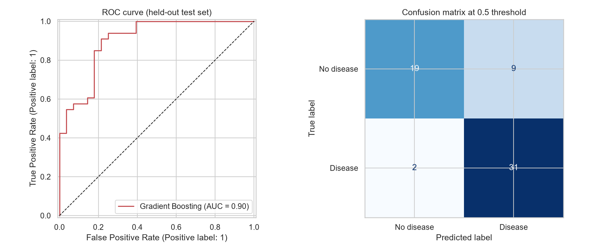
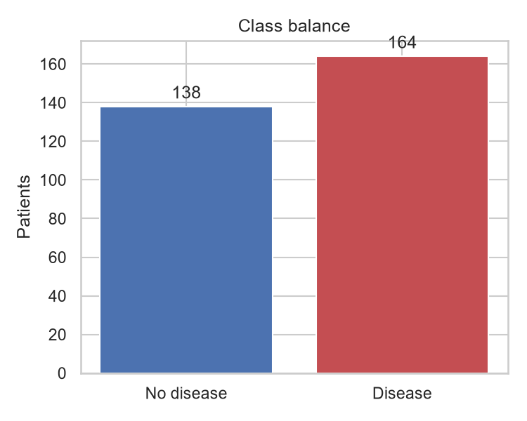
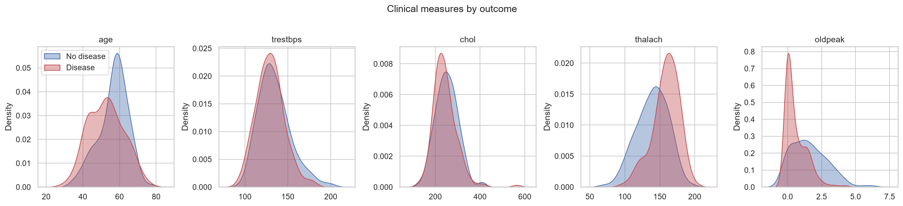
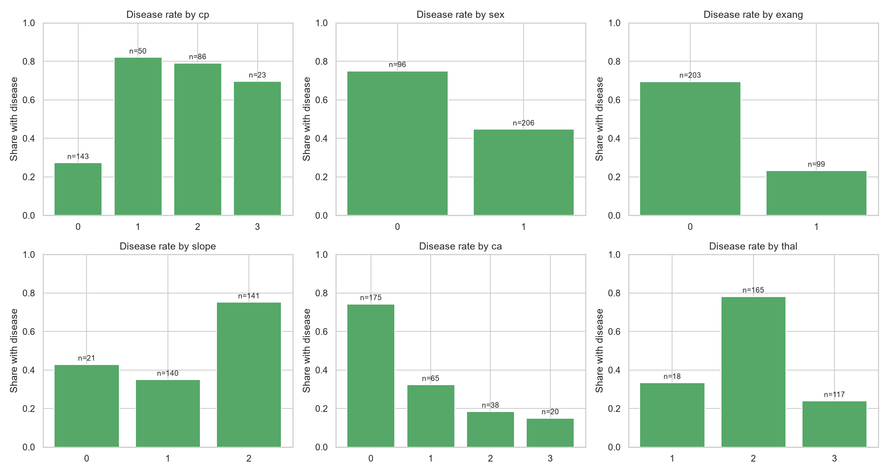
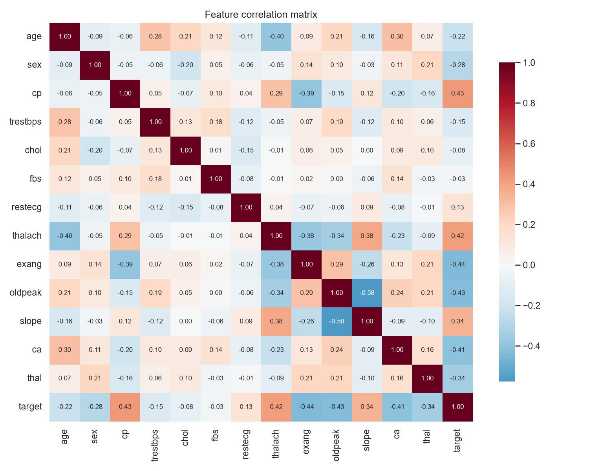
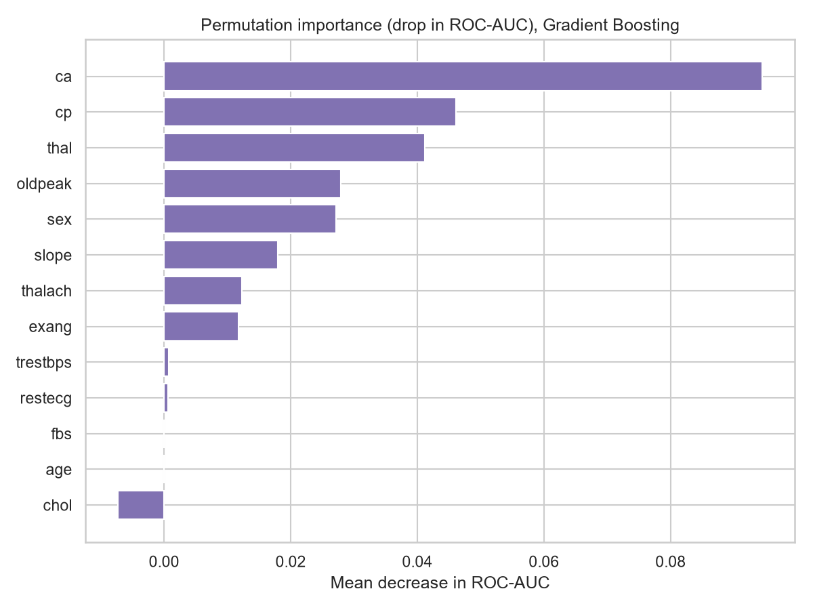

# Heart Disease Risk Prediction: A Data Science Workflow

An end-to-end machine learning workflow on a clinical dataset: data cleaning, exploratory analysis, a controlled comparison of four classifiers with cross-validation, held-out evaluation with confidence intervals, and feature interpretation.

> **Educational project.** Not a medical device and not for clinical use. The model is trained on a small public dataset and is intended to demonstrate a data science workflow, not to diagnose anyone.

---

## Results at a glance

| Metric (held-out test set, n = 61) | Value |
|---|---|
| ROC-AUC | **0.90** (95% bootstrap CI 0.82 to 0.97) |
| Recall (sensitivity) | **0.94** (31 of 33 patients with disease found) |
| Precision | 0.78 |
| Accuracy | 0.82 |
| F1-score | 0.85 |

The model was selected with 5-fold stratified cross-validation on the training split, so the test set was used only once, for the final report.



---

## Problem

Cardiovascular disease is a leading cause of death, and early risk screening can help prioritize follow-up. This project asks: **given 13 routine clinical measurements, how well can a model separate patients with and without heart disease, and which measurements drive that decision?**

## Data

- **Source:** the widely used heart disease dataset from the UCI Machine Learning Repository (Cleveland subset), 303 records, 13 features, binary target.
- **Cleaning:** removed 1 exact duplicate record (302 rows remain). No missing values.
- **Class balance:** 54% positive, so accuracy alone is a weak metric. This project reports ROC-AUC and recall as primary metrics.
- **Stratified split:** 80% train (241) / 20% test (61), stratified on the target and fixed at seed 42.

| Feature | Meaning |
|---|---|
| age, sex | Demographics (sex: 1 = male, 0 = female) |
| cp | Chest pain type (4 levels) |
| trestbps, chol | Resting blood pressure, serum cholesterol |
| fbs, restecg | Fasting blood sugar, resting ECG result |
| thalach, exang, oldpeak, slope | Max heart rate, exercise-induced angina, ST depression, ST slope |
| ca, thal | Number of major vessels colored by fluoroscopy, thalassemia type |

## Exploratory analysis

**Class balance**



**Clinical measures by outcome.** The two groups differ most on `thalach` (max heart rate) and `oldpeak` (ST depression), with the `target = 1` group sitting higher on max heart rate and lower on ST depression. Note that this is the *opposite* of the direction usually reported in cardiology for these two measures. See the data caveat below.



**Disease rate by categorical feature.** Chest pain type, number of vessels, and thalassemia type all show clear differences in disease rate. Bars with fewer than five patients are hidden to avoid unstable rates.



**Correlations.** The strongest univariate correlates with the target are exercise-induced angina (r = -0.44), ST depression (-0.43), number of vessels (-0.41), chest pain type (+0.43), and max heart rate (+0.42). Signs are shown as computed from the data.

> **Data caveat.** Several associations here run against the clinical literature (for example, exercise-induced angina and vessel count are negatively correlated with `target = 1`, while chest pain type is positively correlated). This suggests the target coding may not match the original documentation for every feature. Before reporting clinical interpretations, verify the coding against the dataset's source. The models are unaffected, because they learn whatever mapping the data contains, but the medical story should not be taken at face value.



## Modelling approach

1. **Baseline.** Predicting the majority class gives ROC-AUC 0.50 by construction, which sets the floor.
2. **Candidates.** Four models, each with a small hyperparameter grid searched on training data only:
   - Logistic regression (with standardization)
   - SVM with RBF kernel (with standardization)
   - Random forest
   - Gradient boosting
3. **Selection.** 5-fold stratified cross-validation on the training split, ranked by ROC-AUC.
4. **Final evaluation.** The selected model is refit on the full training split and scored once on the held-out test set. A bootstrap over the test predictions gives a 95% confidence interval.
5. **Interpretation.** Permutation importance on the test set, measured as the drop in ROC-AUC when each feature is shuffled.

### Model comparison (5-fold CV on the training split)

| Model | CV ROC-AUC | CV accuracy | CV recall | CV F1 |
|---|---|---|---|---|
| **Gradient boosting** (selected) | **0.903 ± 0.039** | 0.838 ± 0.083 | 0.877 ± 0.075 | 0.856 ± 0.071 |
| Random forest | 0.900 ± 0.059 | 0.847 ± 0.055 | 0.878 ± 0.062 | 0.862 ± 0.048 |
| Logistic regression | 0.895 ± 0.057 | 0.822 ± 0.059 | 0.893 ± 0.044 | 0.846 ± 0.045 |
| SVM (RBF) | 0.888 ± 0.058 | 0.830 ± 0.060 | 0.924 ± 0.034 | 0.858 ± 0.041 |
| Majority-class baseline | 0.500 | 0.544 | 1.000 | 0.704 |

**Honest reading of the table.** The top three models are within one standard deviation of each other. The selection rule picked gradient boosting by a small margin. The clear result is that every real model beats the baseline by a wide margin, and the choice between the top models is not statistically meaningful at this sample size. A logistic regression would be a defensible choice if interpretability mattered more than a small ROC-AUC gap.

### Which features matter



The most important features on the test set were the number of major vessels (`ca`), chest pain type (`cp`), thalassemia type (`thal`), ST depression (`oldpeak`), and sex. These features also carried the strongest univariate signals. Because of the coding caveat above, the direction of their effects should not be read as clinical evidence.

## Repository layout

```
showcase/
├── analysis/
│   └── heart_analysis.py        # EDA, model comparison, evaluation, figures
├── data/
│   └── heart.csv                # public UCI heart disease dataset
├── figures/                     # generated plots used in this README
├── results/
│   ├── metrics.json             # final metrics and comparison, machine-readable
│   └── model_comparison.csv
├── screenshots/
│   └── banner.png
├── requirements.txt
└── README.md
```

## Reproduce the analysis

```bash
pip install -r requirements.txt
python analysis/heart_analysis.py
```

This regenerates `figures/` and `results/` from `data/heart.csv`. It runs in a few minutes on a laptop.

## Limitations

- **Small dataset.** 302 patients from a single site, collected decades ago. Results will not transfer to other populations without re-validation.
- **Small test set.** 61 patients gives a wide confidence interval (0.82 to 0.97 for ROC-AUC). Model differences of a few points are within noise.
- **No calibration study.** The model's predicted probabilities have not been checked against observed risk, so they should not be read as true risk percentages.
- **Threshold choice.** The 0.5 threshold was not tuned for a clinical cost trade-off. A screening setting would likely use a lower threshold to favor recall.
- **Target coding.** See the data caveat above. Clinical conclusions depend on verifying the labels.
- **Not validated for any clinical use.**

## What I would do next

- Collect or access a larger, more recent, multi-site dataset and validate externally.
- Calibrate the probabilities (for example with isotonic regression) and report calibration curves.
- Tune the decision threshold against an explicit cost ratio between false negatives and false positives.
- Add SHAP explanations for individual predictions.
- Verify the target coding against the dataset's documentation and re-run the analysis.

## Tech stack

Python · pandas · NumPy · scikit-learn · Matplotlib · Seaborn

## Acknowledgements

Dataset: UCI Machine Learning Repository, Heart Disease data set (Cleveland).
